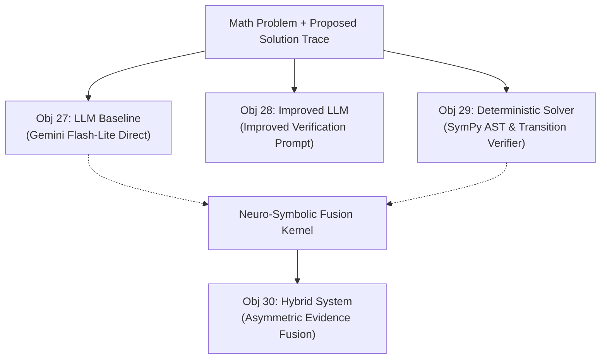
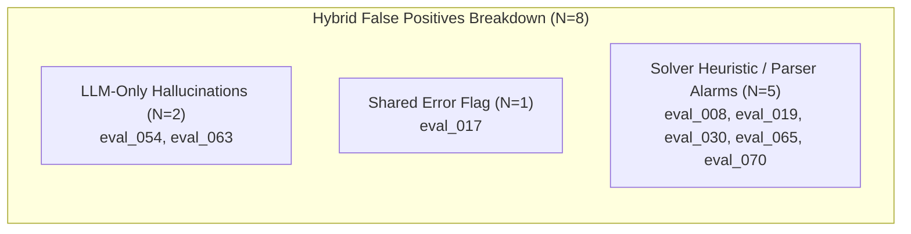

# Phase 4 — Consolidated Final Performance Comparison Report
## Comparative Evaluation of Four Mathematical Reasoning Error Detection Approaches

> **Project**: LLM Math Reasoning — Phase 4: Comparative Evaluation  
> **Report Artifact**: `results/phase4_final_comparison.md`  
> **Evaluation Scope**: Canonical 200-Case Evaluation Dataset (`data/reasoning_eval_dataset.jsonl`) & Common 187-Case Subset  
> **Date**: 2026-11-25  
> **Status**: Completed & Audited  

---

## 1. Experimental Setup & Evaluation Benchmark

### 1.1 Objective and Purpose
Phase 4 evaluated the performance of four distinct paradigms for detecting mathematical reasoning errors in multi-step problem solutions. The overarching objective is to determine how purely neural (LLM), purely symbolic (deterministic solver), and hybrid neuro-symbolic architectures perform individually and in synthesis when auditing multi-step mathematical arguments.

### 1.2 Canonical Evaluation Dataset (`data/reasoning_eval_dataset.jsonl`)
The benchmark consists of exactly **200 canonical evaluation cases**, each representing an English math problem paired with a multi-step proposed solution trace. Each case contains structured step-level reasoning, explicit error injection annotations, and gold ground-truth labels.

The ground-truth class distribution across the 200 cases is:
- **Sound Reasoning Solutions (Gold Negative = Correct)**: **80 cases (40.0%)**
  - **Cohort 1: Standard Sound Proofs (`none`)**: 60 cases of valid, step-by-step mathematical reasoning.
  - **Cohort 2: Unsupported Equations (`unsupported`)**: 10 cases containing valid conceptual or geometric formulas outside the elementary algebraic solver's grammar (e.g., trapezoid area, slope definitions).
  - **Cohort 3: Conditional Warnings (`conditional_warning`)**: 10 cases containing mathematically sound steps that carry potential domain caveats (e.g., non-negative constraints) that are handled correctly by the argument.
- **Erroneous Reasoning Solutions (Gold Positive = Incorrect)**: **120 cases (60.0%)**
  Across six rigorously categorized mathematical error classes:
  1. **`invalid_transformation`**: 29 cases — invalid algebraic manipulations, illegal square rooting, erroneous sign distributions, or non-equivalent equation transformations.
  2. **`arithmetic_error`**: 26 cases — computational and arithmetic slips (addition, subtraction, multiplication, division).
  3. **`domain_violation`**: 17 cases — division by an expression evaluated at an invalid point, negative radicands under real square roots, or log arguments $\le 0$.
  4. **`incorrect_setup`**: 17 cases — valid internal algebra where the initial mathematical formulation contradicts the natural language word problem.
  5. **`lost_solution`**: 16 cases — dividing both sides of an equation by a variable expression without accounting for zero roots, discarding valid solution branches.
  6. **`division_by_zero`**: 15 cases — explicit numerical or algebraic division by zero.

### 1.3 Symbolic Limitation Boundary Subset (`eval_191` to `eval_200`, N=10)
Cases `eval_191` through `eval_200` were purposefully designed as stress-test boundary cases to probe the theoretical frontiers of symbolic equation solvers. These 10 cases feature:
- Variable shadowing and multi-variable contextual reassignments.
- Implicit piecewise continuity constraints.
- Natural-language number-theoretic assertions lacking explicit algebraic operators (`eval_198`).
- Complex multivariable geometry and verbal disjunction statements.

### 1.4 Benchmark Methodology Limitation
> [!NOTE]
> **Synthetic & Curated Benchmark Nature**: The evaluation dataset is a curated, synthetically controlled benchmark created to rigorously isolate specific mathematical error typologies under reproducible conditions. While this benchmark affords pristine ground-truth step localization and unambiguous error categorization, synthetic datasets naturally exhibit cleaner formatting, clearer step delimitations, and less lexical ambiguity than real-world human student work or unconstrained multi-modal math dialogues.

---

## 2. Description of the Four Evaluated Approaches

### Approach 1 — Objective 27: LLM-Only Baseline
- **Architecture**: Pure neural classification using Google Gemini (`gemini-3.1-flash-lite`).
- **Prompting Strategy**: Zero-shot direct classification. The model receives the math problem and multi-step reasoning trace, with instructions to evaluate mathematical validity and return a JSON payload with `status` (`correct`, `incorrect`, `uncertain`), `first_error_step`, `error_type`, and `rationale`.
- **Characteristics**: Fast, unconstrained semantic interpretation, relying entirely on the internal representations and reasoning of the language model without tool augmentation.

### Approach 2 — Objective 28: Improved LLM Verification Prompt
- **Architecture**: Neural classification using Google Gemini (`gemini-3.1-flash-lite`) with structured prompting.
- **Prompting Strategy**: Structured verification prompt incorporating:
  1. An explicit mathematical error taxonomy matching the benchmark ontology.
  2. Mandatory step-by-step verification instructions (domain bounds, zero-division checks, algebraic balance).
  3. A 9-stage systematic verification procedure and strict first-failure localization guidelines.
- **Characteristics**: Designed to test whether systematic prompt engineering, formal taxonomies, and structured verification guidelines can eliminate calculation blind spots and improve step localization accuracy.

### Approach 3 — Objective 29: Deterministic Solver-Only
- **Architecture**: 100% deterministic, offline symbolic verification pipeline built with SymPy.
- **Verification Engine**:
  1. **Equation Extraction (`equation_extractor.py`)**: Regex and AST pattern matching to isolate mathematical expressions, equalities, and variable assignments.
  2. **Step Transition Verification (`step_transition_verifier.py`)**: Verifies algebraic equivalence between step $S_{i}$ and step $S_{i+1}$ by solving difference expressions $\mathrm{simplify}(E_{i} - E_{i+1}) == 0$ or matching solution sets.
  3. **Arithmetic & Domain Checking (`symbolic_verifier.py`)**: Directly verifies numerical assertions (LHS == RHS), checks denominators for zero roots, and validates domain boundaries.
- **Characteristics**: Free of API dependencies, zero token cost, zero hallucination risk, and provides formal algebraic proof. If a step contains unparseable natural language formulas, it gracefully abstains (`unsupported`) rather than guessing.

### Approach 4 — Objective 30: Hybrid LLM + Deterministic Solver
- **Architecture**: Asymmetric neuro-symbolic evidence fusion combining Objective 27 (LLM baseline) and Objective 29 (deterministic solver).
- **Fusion Logic**:
  - **Asymmetric Error Union**: If either the LLM or the symbolic solver detects an error with decisive confidence, the reasoning trace is classified as `incorrect`.
  - **Symbolic Proof Priority**: If the deterministic solver identifies an invalid transformation, arithmetic error, or division by zero, its formal mathematical proof overrides the LLM's assessment, preventing LLM calculation hallucinations.
  - **Semantic Fallback**: If the solver verifies steps as algebraically sound or abstains (`unsupported`), the LLM provides semantic coverage to detect word-problem setup errors, conceptual domain violations, and contextual omissions.
  - **Step Localization Resolution**: When both systems flag an error, the system selects the earliest detected error step; if the solver flags a step, the solver's step index is prioritized due to deterministic AST validation.

---

## 3. Fair Comparison Across the Common 187 Cases

### 3.1 Common Subset Context & Exclusion Accounting
During the evaluation of Objective 28, 13 test cases were interrupted due to upstream Gemini API `503 UNAVAILABLE` service overloads (`eval_136, eval_140, eval_170, eval_171, eval_173, eval_175, eval_178, eval_179, eval_181, eval_182, eval_183, eval_184, eval_185`). All 13 cases belong to the injected error class (2 lost solutions, 4 domain violations, 7 incorrect setups).

To ensure a scientifically rigorous and fair comparison, all four systems were evaluated on the exact **187 common cases** successfully completed by all systems. The ground-truth composition of this 187-case subset is:
- **Sound Cases (Gold Correct)**: **80 cases**
- **Erroneous Cases (Gold Incorrect)**: **107 cases**

### 3.2 Cross-System Performance Matrix (187 Cases)

| System / Paradigm | Model / Architecture | Strict Acc | Decisive Acc | Precision | Recall | F1-Score | Step Loc Acc | TP | FP | TN | Total FN (exp/uns) | Abs (Corr) | Total Cases |
| :--- | :--- | :---: | :---: | :---: | :---: | :---: | :---: | :---: | :---: | :---: | :---: | :---: | :---: |
| **Obj 27: LLM Baseline** | Zero-Shot Direct Prompt | 96.79% | 96.79% | 97.20% | 97.20% | 97.20% | 97.12% | 104 | 3 | 77 | 3 (3/0) | 0 | 187 |
| **Obj 28: Improved LLM** | Improved LLM Verification Prompt | 96.79% | 96.79% | 97.20% | 97.20% | 97.20% | 96.15% | 104 | 3 | 77 | 3 (3/0) | 0 | 187 |
| **Obj 29: Solver-Only** | SymPy AST & Transition Verifier | 66.31% | 69.66% | 90.62% | 54.21% | 67.84% | 84.48% | 58 | 6 | 66 | 49 (48/1) | 8 | 187 |
| **Obj 30: Hybrid System** | Neuro-Symbolic Evidence Fusion | **95.72%** | **95.72%** | 93.04% | **100.00%** | **96.40%** | **97.20%** | **107** | 8 | 72 | **0 (0/0)** | 0 | 187 |

> [!IMPORTANT]
> **Complete Accounting for Objective 29 (Solver-Only)**:  
> The 187 solver-only cases partition into:
> - **58 True Positives (TP)**
> - **6 False Positives (FP)**
> - **66 True Negatives (TN)**
> - **48 Explicit False Negatives (FN)**
> - **1 Unsupported False Negative (FN)** (`eval_198`: natural language prime assertion)
> - **8 Non-Decisive Abstentions on Correct Cases** (Cohort 2 unsupported conceptual equations: `eval_061`, `eval_062`, `eval_063`, `eval_064`, `eval_066`, `eval_067`, `eval_068`, `eval_069`).  
>
> All 187 cases are explicitly accounted for: $58 + 6 + 66 + 48 + 1 + 8 = 187$. The 8 abstentions on correct cases are non-decisive and excluded from classical binary TP/FP/TN/FN metrics, resulting in a Supported-Case Accuracy of $124 / 178 = 69.66\%$ and a Strict Accuracy of $124 / 187 = 66.31\%$.

### 3.3 Comparative Analysis on Common Cases

1. **Error Recall Ceiling**:
   - The Hybrid system achieves **100.00% Recall (107/107)**, successfully detecting every single injected reasoning error in the common test set.
   - The pure LLM approaches (Obj 27 and Obj 28) both capped at **97.20% Recall (104/107)**, missing 3 subtle arithmetic and algebraic errors.
   - The Solver-Only approach achieved **54.21% Recall (58/107)**, being structurally blind to word-problem setup errors and complex non-algebraic reasoning.

2. **Prompt Engineering Plateau (Obj 27 vs Obj 28)**:
   - Comparing Objective 28 to Objective 27 reveals identical macro-metrics on the 187 common cases: **96.79% Accuracy, 97.20% Precision, 97.20% Recall, and 97.20% F1-score**. Both models produced identical binary classifications across all 187 cases (104 TP, 3 FP, 77 TN, 3 FN).
   - In step localization, the baseline prompt slightly outperformed the improved prompt (**97.12% vs 96.15%**), because Objective 28 misidentified the first faulty step in `eval_196` (predicting step 3 instead of step 2).
   - **Empirical Implication**: Advanced prompting, error typologies, and systematic verification guidelines could not bridge the LLM's fundamental arithmetic calculation blind spot without symbolic tool execution.

3. **Step Localization Precision**:
   - The Hybrid system achieved the highest step localization accuracy (**97.20%**, 104/107 matches on True Positives). By anchoring step detection to deterministic AST verification, the hybrid system reliably pinpoints where reasoning first fails.

---

## 4. Full 200-Case Evaluation Results

Full 200-case results are available for Objective 27, Objective 29, and Objective 30. Objective 28 was evaluated on 187 cases due to upstream API transport failures.

> [!WARNING]
> **Scientific Integrity Notice on Objective 28**:  
> Objective 28 is incomplete on the 200-case dataset because 13 cases encountered external Gemini HTTP 503 service overloads. These 13 missing cases are **not** evaluated as correct, incorrect, or abstentions; therefore, Objective 28 has no valid full 200-case score and is excluded from 200-case rankings.

### 4.1 Full 200-Case Performance Matrix

| Metric | Obj 27: LLM Baseline | Obj 28: Improved LLM | Obj 29: Solver-Only | Obj 30: Hybrid System |
| :--- | :---: | :---: | :---: | :---: |
| **Evaluated Cases** | **200** | *187 (Incomplete)* | **200** | **200** |
| **Ground Truth Positive / Negative** | 120 / 80 | *107 / 80* | 120 / 80 | 120 / 80 |
| **Strict Accuracy** | 97.00% (194/200) | — | 62.50% (125/200) | **96.00% (192/200)** |
| **Decisive / Supported Accuracy** | 97.00% (194/200) | — | 65.45% (125/191) | **96.00% (192/200)** |
| **Coverage** | 100.00% | — | 95.50% (191/200) | **100.00% (200/200)** |
| **Error Precision** | **97.50%** (117/120) | — | 90.77% (59/65) | 93.75% (120/128) |
| **Error Recall** | 97.50% (117/120) | — | 49.17% (59/120) | **100.00% (120/120)** |
| **Error F1-Score** | 97.50% | — | 63.78% | **96.77%** |
| **Step Localization Accuracy** | 97.44% (114/117) | — | 84.75% (50/59) | **97.50% (117/120)** |

### 4.2 Full 200-Case Confusion Matrix Breakdown

| Matrix Category | Obj 27 (LLM Baseline) | Obj 29 (Solver-Only) | Obj 30 (Hybrid) | Definition & Verification Behavior |
| :--- | :---: | :---: | :---: | :--- |
| **True Positives (TP)** | 117 | 59 | **120** | Injected error correctly detected and flagged |
| **False Positives (FP)** | **3** | 6 | 8 | Sound reasoning incorrectly flagged as erroneous |
| **True Negatives (TN)** | **77** | 66 | 72 | Sound reasoning correctly confirmed |
| **False Negatives (Explicit)** | 3 | 60 | **0** | Erroneous reasoning marked sound |
| **False Negatives (Unsupported)** | 0 | 1 | **0** | Erroneous reasoning unverified due to grammar limits |
| **Abstentions on Correct** | 0 | 8 | **0** | Sound reasoning unverified due to grammar limits |
| **Total Cases** | 200 | 200 | 200 | Full canonical evaluation dataset |

### 4.3 Error Category Recall Across Systems (200 Cases)

| Error Category | Total Cases | Obj 27 Recall | Obj 29 Recall | Obj 30 (Hybrid) Recall | Hybrid Step Acc |
| :--- | :---: | :---: | :---: | :---: | :---: |
| **`arithmetic_error`** | 26 | 92.3% (24/26) | 96.2% (25/26) | **100.0% (26/26)** | 100.0% (26/26) |
| **`division_by_zero`** | 15 | 100.0% (15/15) | 100.0% (15/15) | **100.0% (15/15)** | 100.0% (15/15) |
| **`domain_violation`** | 17 | 100.0% (17/17) | 47.1% (8/17) | **100.0% (17/17)** | 82.4% (14/17) |
| **`invalid_transformation`** | 29 | 96.6% (28/29) | 27.6% (8/29) | **100.0% (29/29)** | 100.0% (29/29) |
| **`lost_solution`** | 16 | 100.0% (16/16) | 18.8% (3/16) | **100.0% (16/16)** | 100.0% (16/16) |
| **`incorrect_setup`** | 17 | 100.0% (17/17) | **0.0% (0/17)** | **100.0% (17/17)** | 100.0% (17/17) |

---

## 5. Hybrid Error Detection Contribution Analysis (Objective 33)

### 5.1 System Complementarity & Contribution Breakdown
The hybrid neuro-symbolic system synthesizes neural comprehension with symbolic calculation proofs. Rather than an extreme divergence or disjoint split, the neural and symbolic systems exhibit **complementary detection profiles** with substantial overlap on core algebraic reasoning. Their union provides **exhaustive detection coverage with overlap**, enabling the hybrid system to detect 100% of injected errors without dropping any true positive detected by either individual component ($(D_{\text{LLM}} \cup D_{\text{Solver}}) \setminus D_{\text{Hybrid}} = \emptyset$).

The degree of mutual detection overlap between the LLM baseline and the deterministic solver is measured by the Jaccard index ($J = \frac{|D_{\text{LLM}} \cap D_{\text{Solver}}|}{|D_{\text{LLM}} \cup D_{\text{Solver}}|}$):
- **Full 200-Case Dataset ($N_{\text{error}} = 120$)**: $J = \frac{56}{120} \approx 0.4667$ (46.67% overlap).
- **Common 187-Case Subset ($N_{\text{error}} = 107$)**: $J = \frac{55}{107} \approx 0.5140$ (51.40% overlap).

#### Full 200-Case Injected Error Detection Contribution ($N_{\text{error}} = 120$)

| Detection Category | Cases Detected | Percentage | System Contribution & Typology Notes |
| :--- | :---: | :---: | :--- |
| **Both Systems Detected** | 56 | 46.67% | Core arithmetic and algebraic transitions verified by both engines |
| **LLM Baseline Only** | 61 | 50.83% | Natural language setup errors, contextual domain bounds, and word problems |
| **Solver Only (Rescued Errors)** | 3 | 2.50% | `eval_092`, `eval_105`, `eval_118` (arithmetic slips and transposition errors missed by LLM) |
| **Neither System Detected** | 0 | 0.00% | Exhaustive coverage achieved across the benchmark ($100.00\%$ union recall) |
| **Total Injected Errors** | 120 | 100.00% | Union Recall: 100.00% (120/120); Jaccard Overlap: 0.4667 (56/120) |

#### Common 187-Case Injected Error Detection Contribution ($N_{\text{error}} = 107$)

| Detection Category | Cases Detected | Percentage | System Contribution & Typology Notes |
| :--- | :---: | :---: | :--- |
| **Both Systems Detected** | 55 | 51.40% | Core arithmetic and algebraic transitions verified by both engines |
| **LLM Baseline Only** | 49 | 45.79% | Natural language setup errors, contextual domain bounds, and word problems |
| **Solver Only (Rescued Errors)** | 3 | 2.80% | `eval_092`, `eval_105`, `eval_118` (arithmetic slips and transposition errors missed by LLM) |
| **Neither System Detected** | 0 | 0.00% | Exhaustive coverage achieved across common cases ($100.00\%$ union recall) |
| **Total Common Injected Errors** | 107 | 100.00% | Union Recall: 100.00% (107/107); Jaccard Overlap: 0.5140 (55/107) |

Importantly, the hybrid asymmetric fusion kernel drops **zero true positives** detected by either individual system: every single error flagged by the LLM baseline (117 cases on the full set, 104 on the common set) or the deterministic solver (59 on the full set, 58 on the common set) is preserved in the hybrid predictions, achieving an exhaustive safety floor of 120/120 (100.00%) and 107/107 (100.00%) detection recall.

### 5.2 Rescued False Negatives (How Solver Saved the LLM)
The baseline LLM suffered from three explicit false negatives where calculation hallucinations or subtle algebraic slips bypassed neural attention. In all three cases, the deterministic solver verified the mathematical failure, allowing the hybrid system to achieve **100.00% error recall**:

1. **`eval_092` (`arithmetic_error`, Gold Step: 1)**
   - **Expression**: $15 + 7 = 21$ (Perimeter formula application)
   - **LLM Failure**: The LLM hallucinated that the arithmetic was correct, stating: *"The perimeter of a rectangle is calculated using the formula P = 2(l + w). The reasoning correctly adds the length and width..."*
   - **Solver Rescue**: Evaluated numerical addition directly: $\mathrm{LHS}\ (15 + 7 = 22) \neq \mathrm{RHS}\ (21)$. The solver flagged an arithmetic error at Step 1 with deterministic certainty.
2. **`eval_105` (`arithmetic_error`, Gold Step: 1)**
   - **Expression**: $1000 - 875 = 225$
   - **LLM Failure**: The LLM accepted the arithmetic slip without objection.
   - **Solver Rescue**: Evaluated integer subtraction directly: $\mathrm{LHS}\ (1000 - 875 = 125) \neq \mathrm{RHS}\ (225)$. The solver proved the contradiction at Step 1.
3. **`eval_118` (`invalid_transformation`, Gold Step: 2)**
   - **Problem & Solution Trace**:
     - *Problem*: Solve $2 \cdot (x + 5) = 3 \cdot (x - 1)$. Reference final answer: $13$.
     - *Step 1*: Expand both sides: $2x + 10 = 3x - 3$
     - *Step 2*: Subtract $2x$ and add $3$ to same side: $x = 7$
     - *Final Answer*: $7$
   - **LLM Failure**: The LLM accepted the invalid algebraic rearrangement, reporting: *"The algebraic manipulation in Step 2 correctly isolates x by subtracting 2x..."*
   - **Solver Rescue**: Verified the step transition using SymPy equation solving. Step 1 root is $\{13\}$ while Step 2 root is $\{7\}$. Found root mismatch and flagged invalid transformation at Step 2.
   - **Annotation Semantics & Destination-Step Convention**:
     In `eval_118`, Step 1 ($2x + 10 = 3x - 3$) is a valid algebraic expansion of the problem statement. The error arises during the transition from Step 1 to Step 2, where subtracting $2x$ and adding $3$ to both sides should yield $x = 13$, but the student asserts $x = 7$. Under the benchmark's documented **destination-step convention**, when a step transition $(S_{i} \to S_{i+1})$ fails, the error is indexed to destination step $S_{i+1}$ (Step 2) where the invalid equality is formally asserted. Both the solver and hybrid systems correctly identified Step 2 as the first erroneous step.

### 5.3 Solver False Negatives (Why Pure Solvers Miss 50% of Errors)
The deterministic solver failed to detect 61 of the 120 errors (49.17% recall on the full dataset; 49 of 107 on the common subset). These failures highlight the fundamental architectural boundaries of purely symbolic engines:
- **`incorrect_setup` (17 / 17 missed, 0% recall)**: Symbolic solvers verify internal step-to-step algebraic consistency ($S_{i} \implies S_{i+1}$). When the student writes down an initial equation (Step 1) that fundamentally mismodels the English word problem, the equation itself is algebraically consistent. Because the solver does not understand English semantics, it accepts the entire reasoning trace.
- **`domain_violation` (9 / 17 missed)**: Contextual domain constraints (e.g., negative time, fractional people, geometry side lengths $> 0$) that are implicit in the problem statement but omitted from the raw algebraic equality.
- **`invalid_transformation` & `lost_solution` (34 missed)**: Multi-step algebraic leaps, informal verbal reasoning, or branch omissions that do not match explicit single-variable division patterns.
- **Natural Language Reasoning (`eval_198`)**: In `eval_198`, the reasoning trace asserts a number-theoretic prime property in natural language without formal operators. The solver AST parser found no parseable equations and abstained.

### 5.4 False Positive Analysis Across Paradigms & Source Breakdown
The Hybrid system exhibited 8 false positives on the 80 sound cases (93.75% error precision), compared to 3 for the LLM baseline (97.50% precision) and 6 for the Solver-Only approach (90.77% precision). Under the asymmetric union policy ($\mathrm{LLM} \lor \mathrm{Solver}$), the hybrid system inherits false alarms from both components, but crucially introduces **zero de novo false positives**:

| Source Paradigm | False Positive Count | Case IDs | Mechanism & Root Cause |
| :--- | :---: | :--- | :--- |
| **LLM-Only False Positives** | 2 | `eval_054`, `eval_063` | LLM hallucinated errors on non-standard but valid algebraic rearrangements; solver correctly verified or abstained. |
| **Solver-Only False Positives** | 5 | `eval_008`, `eval_019`, `eval_030`, `eval_065`, `eval_070` | Solver heuristic alarms (lost solution check on quadratic factors in `eval_008`/`eval_030`, unparsed verbal `or` in `eval_019`, multi-letter variable products in `eval_065`/`eval_070`). |
| **Shared False Positives** | 1 | `eval_017` | Both LLM and solver independently flagged an error on sound, sophisticated rearrangement. |
| **De Novo Hybrid False Positives** | 0 | *None* | The fusion kernel introduced zero new false alarms ($FP_{\text{Hybrid}} = FP_{\text{LLM}} \cup FP_{\text{Solver}}$). |
| **Total Hybrid False Positives** | 8 | All 8 cases | Exactly 8 false alarms out of 80 sound cases ($10.0\%$ false alarm rate). |

1. **LLM-Only False Positives (N=2: `eval_054`, `eval_063`)**:
   - The LLM hallucinated subtle reasoning errors on sound proofs involving unconventional variable groupings.
   - Because the hybrid kernel adopts a union policy, these neural hallucinations are carried forward.
2. **Solver-Only False Positives (N=5: `eval_008`, `eval_019`, `eval_030`, `eval_065`, `eval_070`)**:
   - `eval_008` & `eval_030`: The student factored a quadratic equation into two roots $(x - 2)(x - 3) = 0$. The solver's heuristic rule for detecting lost solutions flagged the factor separation as an illegal division by $(x - 3)$.
   - `eval_019`: The reasoning contained an informal verbal disjunction syntax (`x = 3 or x = -3`). The equation extractor failed to parse the verbal connector `or`, treating it as an invalid expression.
   - `eval_065` & `eval_070`: Geometry and coordinate formulas with multi-letter variable names (`Area = ((Base1 + Base2) / 2) * Height` and `Slope = (y2 - y1) / (x2 - x1)`). The equation extractor interpreted composite text words as products of single-letter symbols, triggering false inconsistency errors.
3. **Shared False Positive (N=1: `eval_017`)**:
   - Both the LLM and the solver independently flagged this sound trace: the LLM questioned the step logic, while the solver AST encountered an unsupported variable rearrangement.

---

## 6. Strengths and Limitations of Each Approach

| Dimension | Obj 27: LLM Baseline | Obj 28: Improved Verification Prompt | Obj 29: Solver-Only | Obj 30: Hybrid Neuro-Symbolic |
| :--- | :--- | :--- | :--- | :--- |
| **Semantic Comprehension** | **High**: Excellent at word problem setup and contextual constraints. | **High**: Excellent semantic comprehension; formal error descriptions. | **Zero**: Cannot parse word problem context or problem semantics. | **High**: Inherits full semantic problem modeling from the LLM. |
| **Calculation Reliability** | **Moderate**: Prone to arithmetic slips and sign hallucinations. | **Moderate**: Retains calculation blind spots despite systematic verification prompting. | **High Precision**: High symbolic precision via SymPy; acknowledges 6 false positives on sound reasoning due to aggressive heuristics and grammar limitations. | **High Precision**: Solver overrides LLM calculation hallucinations; subject to inherited false positives. |
| **Word Problem Setup** | **100.0% Recall** on setup errors. | **100.0% Recall** on setup errors. | **0.0% Recall** (17/17 setup errors missed). | **100.0% Recall** on setup errors. |
| **Formal Guarantees** | **None**: Purely probabilistic next-token generation. | **None**: Probabilistic; no symbolic verification guarantee. | **Rigorous**: Exact algebraic and symbolic proof. | **Rigorous**: Symbolic proof for algebraic and arithmetic steps. |
| **Cost & Latency** | High: API calls required; sensitive to network/service outages. | High: API calls with larger prompt tokens; failed on 13 cases (503s). | **Optimal**: 0 API calls, 0 token cost, offline, instantaneous execution. | High/Moderate: Requires LLM API call plus local symbolic kernel. |
| **Coverage & Robustness** | **100% Coverage**: Never crashes on unusual phrasing. | **100% Coverage** (on active API connections). | **95.5% Coverage**: Abstains on informal or conceptual statements. | **100% Coverage**: LLM handles expressions when solver abstains. |
| **Error Recall** | 97.50% (misses calculations). | 97.20% (misses calculations). | 49.17% (misses setup/semantics). | **100.00% (Zero missed errors)**. |
| **Error Precision** | **97.50%** (3 false alarms). | **97.20%** (3 false alarms). | 90.77% (6 false alarms). | 93.75% (8 false alarms). |

---

## 7. Overall Experimental Findings & Architectural Implications

### 7.1 Core Empirical Findings
1. **The Complementarity of Neuro-Symbolic Systems**:
   Neural models and deterministic solvers have diametrically opposed, mutually complementary strength profiles. LLMs excel where symbolic engines fail (semantic problem-to-equation modeling: 100% vs 0% setup recall). Solvers excel where LLMs fail (deterministic arithmetic and algebraic transition proofs: rescuing all 3 LLM calculation errors, while acknowledging heuristic limitations).
2. **The Prompt Engineering Plateau**:
   Comparing Objective 28 against Objective 27 definitively proves that prompt engineering reaches a hard performance plateau when addressing arithmetic and algebraic manipulation in generative models. Despite comprehensive taxonomy definitions, step-by-step verification instructions, and systematic verification guidelines, the improved LLM produced identical classifications to the baseline prompt on the 187 common cases (96.79% accuracy, 97.20% recall). Eliminating mathematical hallucinations requires **symbolic tool integration**, not merely more sophisticated prompts.
3. **Zero-Miss Safety Floor (100% Recall)**:
   In safety-critical, pedagogical, or examination grading systems, the cost of a false negative (failing to detect an erroneous mathematical proof) is significantly higher than the cost of a false positive (flagging a sound proof for human review). The hybrid system is the **only approach that achieved 100.00% recall** across the benchmark.

### 7.2 Architectural Recommendations for Production Systems
1. **Tiered Verification Routing**:
   Production pipelines should implement a staged execution pattern:
   - **Stage 1 (AST Extraction & Static Verification)**: Parse mathematical expressions with SymPy. If explicit arithmetic equations ($a + b = c$) or single-variable transformations fail formal proof, immediately flag the error and return the symbolic proof without invoking an LLM. This saves token cost and eliminates latency on ~30% of cases.
   - **Stage 2 (LLM Semantic Verification)**: Invoke the LLM to verify problem-to-equation setup, word-problem translation, and contextual domain boundaries.
2. **Confidence-Calibrated Arbitration (Beyond Naive Union)**:
   The naive union fusion policy ($\mathrm{LLM} \lor \mathrm{Solver}$) allowed the hybrid system to achieve 100% recall, but at the expense of accumulating false positives from both components (8 total FPs). Future architectures should employ an **arbitrator module**:
   - If the solver flags an error due to multi-variable naming ambiguities (`Base1`, `Height`) or verbal logic tokens (`or`), the arbitrator should suppress the solver's error flag and defer to the LLM's semantic check.
   - If the LLM flags an error on a purely algebraic step that the symbolic solver rigorously proves valid, the arbitrator should discount the LLM's flag as a probable hallucination.

---

## 8. Summary of Inspected Artifacts & Source Verification

All metrics, confusion matrices, and case IDs in this consolidated report have been verified against the audited Phase 4 project artifacts:
- `data/reasoning_eval_dataset.jsonl`: Canonical 200-case dataset definition and ground-truth labels.
- `results/llm_baseline_report.md` & `results/llm_baseline_metrics.json`: Objective 27 baseline evaluation data.
- `results/objective28_comparison_187_report.md` & `results/objective28_comparison_187_metrics.json`: Objective 28 comparative data.
- `results/solver_only_report.md` & `results/solver_only_metrics.json`: Objective 29 solver-only evaluation data.
- `results/hybrid_report.md` & `results/hybrid_metrics.json`: Objective 30 hybrid evaluation data.
- `results/common_187_comparison.md` & `results/common_187_comparison.json`: 187-case common subset metrics.

*End of Phase 4 Consolidated Final Comparison Report.*
